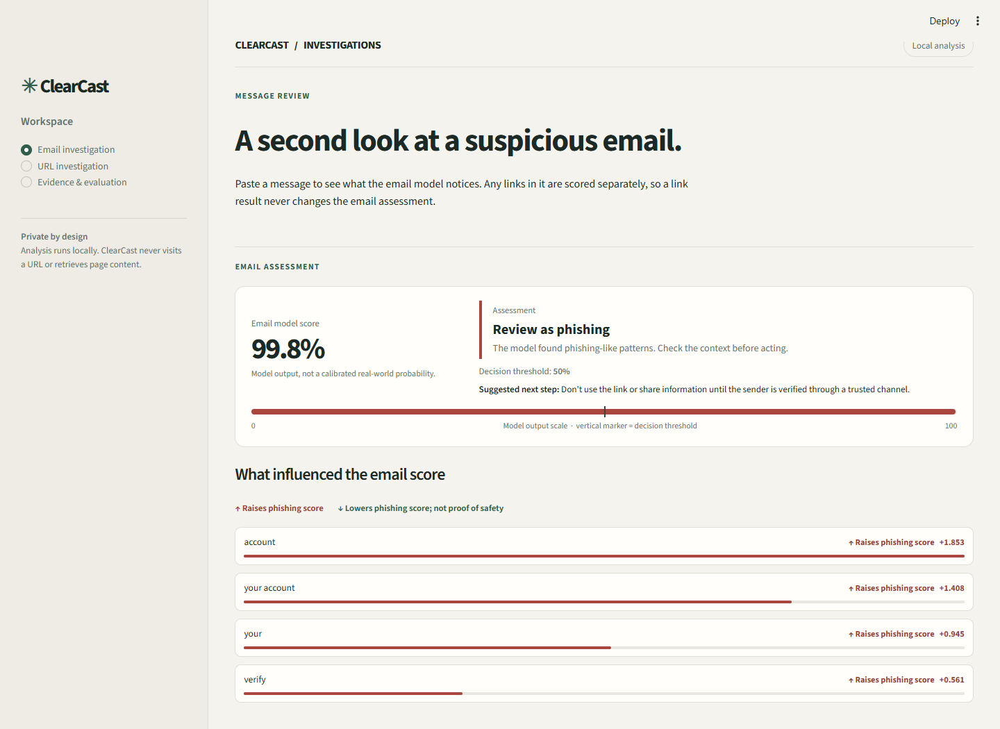
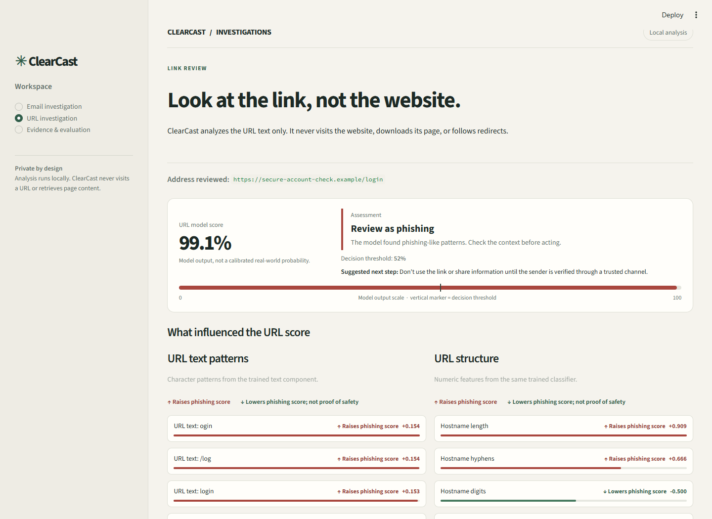
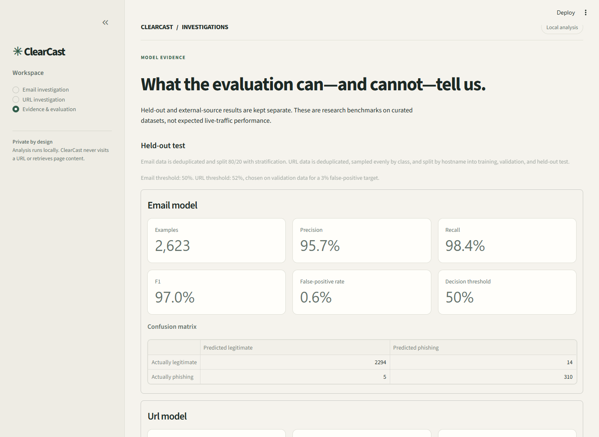

# ClearCast — Explainable Phishing Email & URL Analyzer

**A local-first Streamlit app that helps people inspect suspicious emails and links—and see what influenced each model result.**

ClearCast analyzes pasted email text and URL strings with two independent machine-learning models. It explains each result using the trained model's feature contributions. Links found in an email are analyzed separately and never change the email verdict.

> **Research and awareness tool, not a security guarantee.** Scores are model outputs from curated datasets, not calibrated real-world probabilities. A high score is a reason to review an item, not proof that it is malicious. A low score does not prove that it is safe.



## What you can do

- **Review an email:** paste a subject and message body to get a model score, a threshold-based assessment, and an explanation of influential words and phrases.
- **Inspect embedded links independently:** detected HTTP/HTTPS links are scored by the separate URL model. Their scores do not affect the email result.
- **Inspect a URL:** analyze the URL text and see learned character patterns and structural-feature contributions. ClearCast never visits the destination or downloads page content.
- **Understand the evidence:** compare held-out test results with a separate external-source stress test, including precision, recall, F1, false-positive rate, thresholds, and confusion matrices.
- **Try sample inputs:** load local suspicious and legitimate examples for a quick demonstration.

## Screenshots

| Email investigation | URL investigation |
|---|---|
|  |  |

### Evaluation evidence



## Run locally

**Requirements:** Python 3.11 or 3.12.

```powershell
python -m venv .venv
.\.venv\Scripts\Activate.ps1
python -m pip install -e ".[dev]"
python -m streamlit run app.py
```

Open the local address printed by Streamlit. On macOS/Linux, activate the environment with `source .venv/bin/activate`.

The trained models and evaluation reports are included, so you can run the app without downloading datasets or retraining. The `ml.train` workflow downloads its documented public datasets only if you choose to retrain; see [data sources and licensing](docs/DATA.md).

## How it works

### Email model

Email subject and body text are combined and passed to a word/phrase TF-IDF vectorizer followed by logistic regression. The displayed explanation shows signed contributions from the trained linear model.

### URL model

URL character n-grams are combined with structural features such as hostname and path characteristics in a separate logistic-regression classifier. URL input is validated and analyzed as text; no network request is made.

### Independent results

The email model makes the email assessment. An embedded URL can separately receive a URL assessment, but that score does **not** enter or modify the email prediction.

## Evaluation at a glance

The figures below are copied from the committed evaluation reports. The reports and [evaluation notes](docs/EVALUATION.md) provide split methodology, error reviews, and limitations.

| Evaluation set | Model | Examples | Precision | Recall | F1 | False-positive rate | Threshold |
|---|---:|---:|---:|---:|---:|---:|---:|
| Held-out | Email | 2,623 | 95.68% | 98.41% | 97.03% | 0.61% | 0.50 |
| Held-out | URL | 6,320 | 96.82% | 90.30% | 93.45% | 2.98% | 0.52 |
| External stress test | Email | 283 | 98.78% | 71.05% | 82.65% | 0.59% | 0.50 |
| External stress test | URL | 834 | 85.67% | 67.63% | 75.59% | 13.32% | 0.52 |

External performance—especially for URLs—shows why these models should assist human review rather than make automatic blocking decisions. The training sources have limitations and label/source correlations; see [evaluation and error analysis](docs/EVALUATION.md).

## Development and tests

Run the test suite:

```bash
python -m pytest -q
```

Retraining and external evaluation are optional and download the sources described in the project documentation:

```bash
python -m ml.train
python -m ml.external_eval
```

Every pull request is also checked with the included GitHub Actions workflow on Python 3.11 and 3.12.

## Privacy and scope

- Email text is pasted into the local app; there is no inbox access.
- **Gmail integration is not implemented.** There is no OAuth, Google login, inbox permission, or email API connection.
- URLs are not opened, resolved, or fetched. The URL model only uses the entered URL string.
- No scores are calibrated for live phishing prevalence, and neither model guarantees safety.

## Project guide

- [Setup](docs/SETUP.md)
- [Architecture](docs/ARCHITECTURE.md)
- [Data sources and licenses](docs/DATA.md)
- [Evaluation and error analysis](docs/EVALUATION.md)
- [Hackathon demo flow](docs/DEMO.md)

## Built with

Python · Streamlit · scikit-learn · pandas · joblib

---

Made as a student hackathon project to make phishing-model decisions easier to inspect and discuss.
