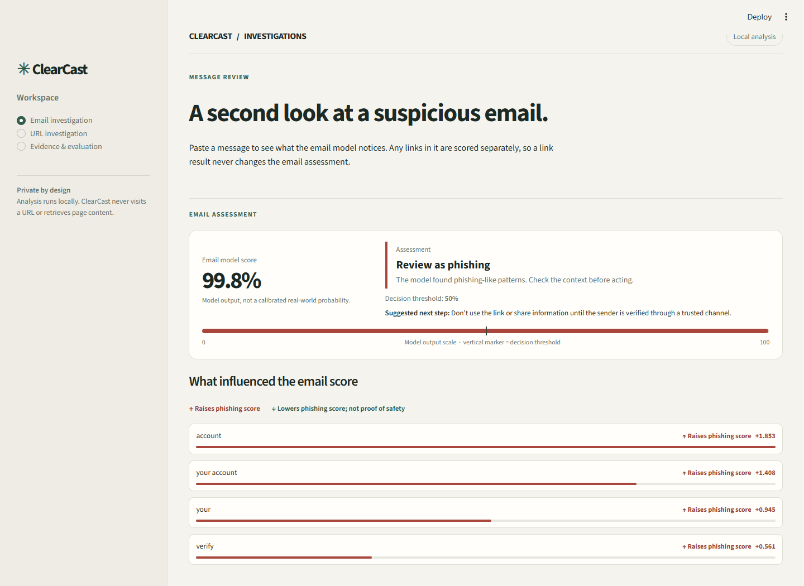
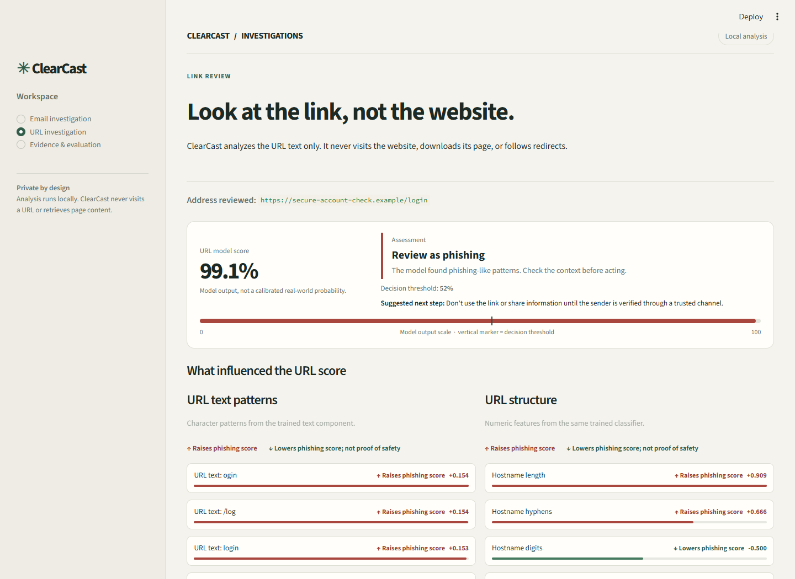
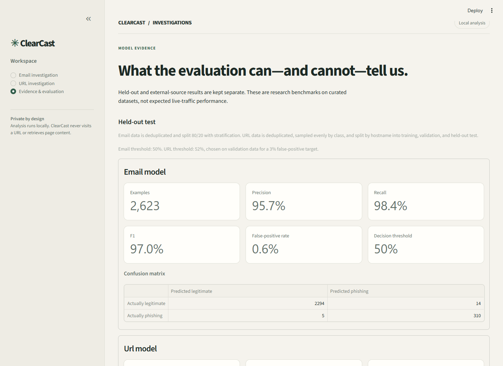

# ClearCast — Phishing Email and URL Analyzer

**Inspect a suspicious email and its links, then see what influenced each model result.**

ClearCast is a local-first Streamlit application with separate machine-learning models for email text and URL strings. It explains model outputs with feature contributions. Links found in an email are analyzed independently and do not change the email assessment.

> **Important:** ClearCast is a student research and awareness project, not a production security product. Scores are model outputs from curated datasets, not calibrated real-world probabilities. A high score is not proof of malicious intent; a low score is not proof that something is safe.



## What ClearCast does

- **Email investigation:** paste a subject and message body, or import Gmail's downloaded original email (`.eml`), to get an assessment and see which words and phrases influenced the email model.
- **Independent link checks:** visible HTTP/HTTPS URLs, `www.` links, and bare dotted hostnames in pasted text are scored separately from the email. Imported emails also contribute hidden HTML hyperlink destinations. URL scores never affect the email verdict.
- **URL investigation:** paste a URL to review learned character patterns and structural-feature contributions.
- **Review history:** see prior assessments, flag repeated email text or URLs, and clear the local history.
- **Evaluation:** inspect held-out test results and a separate external-source stress test, including confusion matrices and documented limitations.
- **Local sample inputs:** load suspicious or legitimate examples to try the workflows.

ClearCast analyzes URL text only. **It does not visit URLs, follow redirects, or retrieve web page content.**

## New: review original Gmail messages locally

You can review the original message rather than copying text out of Gmail:

1. In Gmail, open the email and choose **More (⋮) → Download message**.
2. In ClearCast, choose **Email investigation** and expand **Import an original Gmail message (.eml)**.
3. Select the downloaded `.eml` file, inspect the sender/header context, and choose **Load email into the fields**.
4. Choose **Analyze email**. The email assessment and any discovered link assessments are shown in ClearCast.

This is a local file import—not a Gmail account connection. There is no Google sign-in, OAuth, inbox permission, or Gmail API access. Sender and authentication-result headers such as SPF/DKIM/DMARC are displayed as copied from the file; **ClearCast does not independently verify them**.

## New: find visible and hidden email links

For pasted email text, ClearCast looks for visible HTTP/HTTPS URLs, `www.` links, and bare dotted hostnames. A URL does not need to be clickable to be found. For an imported `.eml`, ClearCast also extracts HTTP/HTTPS targets from HTML anchor `href` attributes, including a hidden address behind text such as **“click here.”**

Each extracted address is sent to the separate URL model; it does not change the email score. ClearCast never opens, resolves, or fetches a link. Link discovery is deliberately bounded to five candidates per email. It is not a full HTML or image analysis system: it does not extract links encoded only in images/QR codes, obfuscated text such as `example dot com`, or arbitrary non-HTTP schemes. Review the original message and links carefully.

## New: revisit prior checks

The **Review history** workspace shows the most recent 100 email and URL assessments, with the time, source, score, threshold, assessment, and whether an earlier matching review exists. ClearCast also flags a repeat while showing its result.

- Email matching normalizes Unicode, ignores case, and collapses whitespace before comparing the subject and body.
- URL matching uses ClearCast's URL normalization, so a bare hostname and the same address with an `https://` scheme can match.
- The database is local to the computer running ClearCast, at `.clearcast/review_history.sqlite3`.
- To make repeat checking possible without retaining email bodies or full URLs, the database stores deterministic SHA-256 fingerprints along with review metadata. It does not store raw messages, senders, or complete URL strings.
- **Important privacy limitation:** a deterministic hash is not encryption or guaranteed anonymization. Someone who already knows a likely message or URL can hash guesses and compare them. The SQLite file itself is not encrypted. Clear history in **Review history → Clear local review history**, and do not use this feature on a shared or untrusted computer if that storage is not appropriate.

## Screenshots

| Email investigation | URL investigation |
|---|---|
|  |  |



## Run ClearCast from GitHub (beginner steps)

These steps assume a Windows computer and PowerShell. No training data download, model training, Gmail sign-in, or API key is needed to run the included app.

### 1. Install the two tools

Install **Python 3.12** from [python.org/downloads](https://www.python.org/downloads/). During installation on Windows, select **“Add python.exe to PATH.”**

Install **Git** from [git-scm.com/downloads](https://git-scm.com/downloads).

After installation, open **PowerShell**. Check that the commands are available:

```powershell
py --version
git --version
```

Python 3.11 and 3.12 are supported. If `py` is not recognized, reopen PowerShell after installing Python. On some computers, use `python --version` instead.

### 2. Download the project

Copy and run these commands in PowerShell:

```powershell
git clone https://github.com/MateUrLuv/clearcast-email-url-security.git
cd clearcast-email-url-security
```

`git clone` creates a new `clearcast-email-url-security` folder and downloads the source code into it. If you already cloned the project, just `cd` into that folder.

### 3. Create a private Python environment for the project

Run:

```powershell
py -3.12 -m venv .venv
```

If you installed Python 3.11 instead, use `py -3.11 -m venv .venv`.

Activate the environment in PowerShell:

```powershell
.\.venv\Scripts\Activate.ps1
```

If PowerShell says script execution is disabled, you can skip activation and use the explicit `.venv\Scripts\python.exe` commands in the troubleshooting section below. You do not need to change your computer's security policy.

### 4. Install the required Python packages

With the environment activated, run:

```powershell
python -m pip install --upgrade pip
python -m pip install -e ".[dev]"
```

This installs Streamlit and the machine-learning dependencies into this project's `.venv` folder. Internet access is needed for the initial package installation.

### 5. Start the app

In the same PowerShell window, run:

```powershell
python -m streamlit run app.py
```

Wait for Streamlit to print a local address, usually `http://localhost:8501`, and open that address in your browser.

Choose **Email investigation**, **URL investigation**, or **Evidence & evaluation** from the app's left sidebar. For a quick demo, click **Load suspicious sample**, then **Analyze email**. You can also paste your own text or a URL.

To stop the app, return to PowerShell and press **Ctrl+C**.

### macOS or Linux

Install Python 3.11 or 3.12 and Git, open Terminal, and run:

```bash
git clone https://github.com/MateUrLuv/clearcast-email-url-security.git
cd clearcast-email-url-security
python3 -m venv .venv
source .venv/bin/activate
python -m pip install --upgrade pip
python -m pip install -e ".[dev]"
python -m streamlit run app.py
```

Open the local address Streamlit prints in your browser. Stop the app with **Ctrl+C**.

## Common setup problems

### “`git` is not recognized”

Install Git, close PowerShell, open it again, and retry the `git --version` command.

### “`py` is not recognized” or the requested Python version is missing

Install Python 3.12 and enable **“Add python.exe to PATH.”** Reopen PowerShell. Depending on your installation, `python -m venv .venv` may work instead of `py -3.12 -m venv .venv`.

### PowerShell does not allow activating `.venv`

Activation is optional. From the project folder run each command with the environment's Python:

```powershell
.\.venv\Scripts\python.exe -m pip install --upgrade pip
.\.venv\Scripts\python.exe -m pip install -e ".[dev]"
.\.venv\Scripts\python.exe -m streamlit run app.py
```

### “No module named streamlit”

The packages were installed into a different Python environment. Activate `.venv` and repeat the install command, or run:

```powershell
.\.venv\Scripts\python.exe -m pip install -e ".[dev]"
```

### Port 8501 is already in use

Stop the other Streamlit window with **Ctrl+C**, or choose a different port:

```powershell
python -m streamlit run app.py --server.port 8502
```

## How it works

- **Email model:** combines subject and readable body text, transforms word and phrase patterns with TF-IDF, then classifies them with a trained logistic-regression model. It does not use embedded URL scores when producing the email score.
- **URL model:** independently combines URL character n-grams and numeric structural features—such as hostname and path structure—in a separate logistic-regression model. It does not use DNS or page contents.
- **Email explanations:** the bars show signed contributions of learned words and phrases. Positive values push the model output toward the phishing class; negative values push it away. They explain this model's output, not the sender's intent, and a negative feature is not proof of safety.
- **URL explanations:** text-pattern and structural-feature contributions are shown separately. Positive and negative values describe how the corresponding learned features shift the URL model's output.
- **Score and threshold:** the score is the model's output for this input, **not a calibrated real-world probability**. It is compared with the displayed decision threshold (email 0.50; URL 0.52, selected using validation data). A score below threshold means the model did not classify the item as phishing; it does not establish that the message or address is legitimate or safe.
- **Independent verdicts:** an email is assessed by the email model; each discovered link is assessed independently by the URL model. URL results never raise, lower, or override the email result.

The checked-in model artifacts and evaluation reports let you run the app immediately after installing dependencies. Retraining is optional and downloads the public datasets documented in [Data sources and licenses](docs/DATA.md). Do not run training unless you intend to download those datasets and replace model/report files.

## Evaluation at a glance

These figures are from the committed evaluation reports. Full methodology, confusion matrices, and limitations are documented in [Evaluation and error analysis](docs/EVALUATION.md).

| Evaluation set | Model | Examples | Precision | Recall | F1 | False-positive rate | Threshold |
|---|---|---:|---:|---:|---:|---:|---:|
| Held-out | Email | 2,623 | 95.68% | 98.41% | 97.03% | 0.61% | 0.50 |
| Held-out | URL | 6,320 | 96.82% | 90.30% | 93.45% | 2.98% | 0.52 |
| External stress test | Email | 283 | 98.78% | 71.05% | 82.65% | 0.59% | 0.50 |
| External stress test | URL | 834 | 85.67% | 67.63% | 75.59% | 13.32% | 0.52 |

External performance—especially for URLs—does not transfer as well as held-out results. These benchmarks are not a promise of performance on future or live messages.

## Run the tests (optional)

After completing setup, run:

```powershell
python -m pytest -q
```

GitHub Actions also runs the tests automatically on pushes and pull requests with Python 3.11 and 3.12.

## Project files

```text
clearcast-email-url-security/
├── app.py                       # Streamlit user interface
├── email_import.py              # Local Gmail .eml parsing, including HTML links
├── review_history.py            # Content-free local review history
├── ml/                          # Models, explanations, training, and evaluation code
├── artifacts/                   # Pre-trained email and URL models
├── reports/                     # Held-out and external evaluation results
├── screenshots/                 # App screenshots for this README
├── tests/                       # Focused automated tests
├── docs/                        # Setup, architecture, data, and evaluation details
├── .github/workflows/tests.yml  # Python 3.11/3.12 test workflow
└── pyproject.toml               # Package metadata and dependencies
```

## Privacy and project scope

- Email can be pasted or imported as a Gmail-downloaded `.eml` file. In Gmail, open a message, choose **More (⋮) → Download message**, then load that file in ClearCast. The app does not access your inbox.
- There is no Google login, OAuth, inbox permission, or Gmail API connection. The `.eml` file is processed by the ClearCast app server; when running locally, that server is on your own computer.
- Sender and authentication-result headers are displayed as supplied in the file. ClearCast does not independently verify SPF, DKIM, or DMARC.
- For imported MIME emails, visible URLs and HTTP/HTTPS destinations in HTML anchor `href` attributes are scored separately without visiting them.
- Review history stores UTC timestamps, item type, source, score, threshold, assessment, and SHA-256 fingerprints in `.clearcast/review_history.sqlite3`. It does not store message bodies, senders, or full URLs. Fingerprints are deterministic, not encryption or anonymization, and the local file is not encrypted; use **Review history → Clear local review history** to delete its records.
- URLs are not opened or fetched. The URL model only uses the URL string.
- A score is not proof of malicious intent or proof of safety. Use human judgment.

## Project documentation

- [Setup](docs/SETUP.md)
- [Architecture](docs/ARCHITECTURE.md)
- [Data sources and licenses](docs/DATA.md)
- [Evaluation and error analysis](docs/EVALUATION.md)
- [Hackathon demo flow](docs/DEMO.md)

## Built with

Python · Streamlit · scikit-learn · pandas · joblib

---

ClearCast is a student hackathon project to make phishing-model decisions easier to inspect and discuss.
